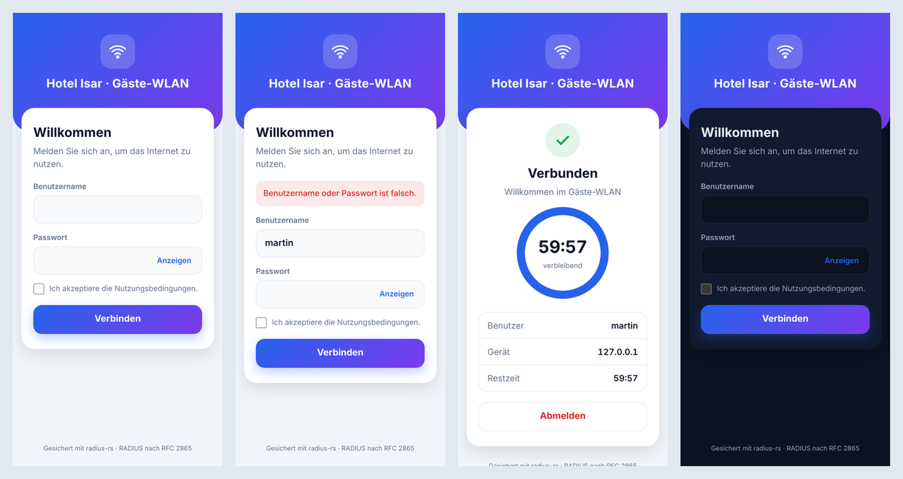
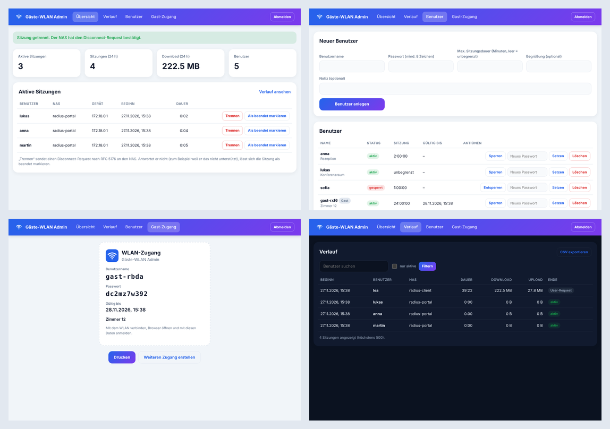

# radius-rs

[](https://github.com/Razafindriatsara/radius-rs/actions/workflows/ci.yml)
[](https://github.com/Razafindriatsara/radius-rs/releases/latest)


Ein schlanker, sicherheitsorientierter RADIUS-Server in Rust.
Er implementiert Authentifizierung (RFC 2865), Accounting (RFC 2866), Message-Authenticator (RFC 3579), Status-Server (RFC 5997) und die Erkennung doppelter Requests (RFC 5080).

> Portfolioprojekt: Netzwerkprotokoll nach RFC, binäres Paketformat, Protokoll-Kryptografie, Async-Rust, SQLite.
> Getestet unter Linux, Windows und macOS sowie gegen `radclient` von FreeRADIUS.

## Was ist RADIUS?

RADIUS ist das Protokoll, mit dem Access Points, Switches und VPN-Gateways (der *NAS*) einen zentralen Server fragen: „Darf sich dieser Benutzer anmelden?“ Danach melden sie, wie lange die Sitzung lief und wie viele Daten übertragen wurden. Es steckt hinter WPA2-Enterprise im Firmen-WLAN, hinter vielen VPN-Zugängen und hinter Internetanschlüssen von Providern.

## Features

- [x] Paket-Codec für Header und Attribute (TLV), robust gegen fehlerhafte Eingaben
- [x] PAP-Authentifizierung mit Argon2-gehashten Passwörtern
- [x] Response Authenticator und Message-Authenticator (HMAC-MD5)
- [x] **BlastRADIUS-Schutz** (CVE-2024-3596): Message-Authenticator wird verlangt und in jeder Antwort als erstes Attribut gesendet
- [x] **Accounting in SQLite**: Start, Interim-Update, Stop, Accounting-On/Off, 64-Bit-Zähler über Gigawords
- [x] **Erkennung doppelter Requests**: Wiederholungen bekommen die gespeicherte Antwort, ohne erneute Prüfung
- [x] Status-Server für Health Checks
- [x] Pro-Client Shared Secrets, Clients als einzelne IP oder Netz (CIDR, IPv4/IPv6), unbekannte Clients werden verworfen
- [x] Argon2 und SQLite laufen im Blocking-Threadpool und bremsen den Async-Server nicht aus
- [x] **Eingangsportal `radius-portal`** (Captive Portal) mit App-Oberfläche: Anmeldung per RADIUS, Accounting Start/Stop, Countdown bis zum Session-Timeout, Schutz vor Brute Force, installierbar als Web-App
- [x] **Admin-Oberfläche** im Browser: aktive Sitzungen trennen (Disconnect nach RFC 5176), Benutzer anlegen, sperren und löschen ohne Neustart, Gast-Zugänge mit Ablaufzeit zum Ausdrucken, Verlauf mit CSV-Export
- [x] Eigener Testclient `radius-client`, der Antworten kryptografisch prüft
- [x] 52 automatische Tests, darunter Testvektoren aus RFC 2865 und Property-Tests
- [x] **Interoperabilität mit FreeRADIUS**: 15 Tests mit `radclient` laufen bei jedem Push
- [x] **Docker-Image** (121 MB, läuft ohne Root) und Compose-Demo mit Health Check
- [x] **Automatische Releases**: Programme für Linux (x86_64, ARM64), Windows und macOS sowie Multi-Arch-Docker-Image auf ghcr.io
- [x] CI auf GitHub Actions: Tests auf drei Betriebssystemen, FreeRADIUS-Interop, Docker-Build, `rustfmt`, `clippy -D warnings`, `shellcheck`

### Mögliche Erweiterungen

- [ ] RadSec (RADIUS über TLS, RFC 6614) mit `rustls`
- [ ] EAP (PEAP/EAP-TLS) für WPA2-Enterprise
- [ ] CoA-Request (RFC 5176), um laufende Sitzungen zu ändern (zum Beispiel Bandbreite)
- [ ] Prometheus-Metriken
- [ ] Demo mit echter Hardware (OpenWrt-Hotspot), Freigabe im Gateway durch das Portal
- [ ] Fuzzing mit `cargo-fuzz`

## Architektur

```
               UDP 1812 (Auth) / 1813 (Accounting)
NAS ─────────────────────────────────────────────► server.rs
                                                   │  Client-Whitelist
                                                   │  dedup.rs: Duplikat? → gespeicherte Antwort
                                                   ▼
                                             handler.rs   (Protokoll-Logik, ohne Netzwerk testbar)
                              ┌──────────────┬────┴─────────┬──────────────┐
                          packet.rs      crypto.rs     users.rs/auth.rs   accounting.rs
                          (Codec)        (MD5/HMAC)    (SQLite, Argon2)    (SQLite)
                                                            ▲                 ▲
                         admin.rs (HTTP 8090) ──────────────┴─────────────────┘
                              │ Disconnect-Request (UDP 3799, RFC 5176)
                              ▼
                         NAS / radius-portal
```

`handler.rs` arbeitet nur mit Bytes rein und Bytes raus. Dadurch lässt sich die gesamte Protokoll-Logik ohne Sockets testen. Das Benutzer-Backend steckt hinter dem Trait `Authenticator` und lässt sich gegen SQL oder LDAP austauschen.

## Eingangsportal



`radius-portal` ist die Anmeldeseite eines Gäste-WLANs, wie man sie aus Hotels oder Cafés kennt. Das Portal arbeitet selbst als NAS: Es prüft Benutzername und Passwort per RADIUS, meldet Beginn und Ende jeder Sitzung per Accounting und beendet die Sitzung, wenn der vom Server vorgegebene `Session-Timeout` abläuft.

```bash
docker compose up -d portal          # startet Server und Portal → http://localhost:8080
```

Ohne Docker, bei laufendem Server:

```bash
PORTAL_TITLE="Gäste-WLAN" RADIUS_SECRET=testing123 cargo run --bin radius-portal
```

| Variable | Standard | Bedeutung |
|---|---|---|
| `PORTAL_LISTEN` | `0.0.0.0:8080` | Adresse der Weboberfläche |
| `PORTAL_TITLE` | `Gäste-WLAN` | Überschrift |
| `RADIUS_SERVER` / `RADIUS_ACCT_SERVER` | `127.0.0.1:1812` / `:1813` | RADIUS-Server |
| `RADIUS_SECRET` | `testing123` | Shared Secret (muss zum Client-Eintrag in `config.toml` passen) |
| `NAS_IDENTIFIER` | `radius-portal` | Name des Portals in den Accounting-Daten |
| `PORTAL_SECURE_COOKIE` | `0` | `1` = Cookie nur über HTTPS (hinter einem TLS-Proxy) |
| `PORTAL_MAX_FAILURES` | `5` | Fehlversuche pro IP in 5 Minuten, danach Sperre |
| `PORTAL_COA_LISTEN` | `0.0.0.0:3799` | Empfang von Disconnect-Requests (RFC 5176), leer = aus |

**Sicherheit:** Sitzungs-Cookie mit 128 Bit aus dem Zufallsgenerator des Betriebssystems, `HttpOnly` und `SameSite=Strict`; Content-Security-Policy ohne Inline-Skripte; alle Ausgaben HTML-maskiert, auch die Reply-Message des Servers; Sperre nach wiederholten Fehlversuchen; jede RADIUS-Antwort wird über Response Authenticator und Message-Authenticator geprüft.

**Grenze:** Das Portal gibt keinen Internetzugang in der Firewall frei. In einem echten Hotspot übernimmt das ein Gateway (zum Beispiel OpenWrt mit nftables), das Portal liefert Anmeldung, Sitzungsverwaltung und RADIUS-Anbindung.

## Admin-Oberfläche



Die Admin-Oberfläche läuft im Server-Prozess und nutzt dieselbe Datenbank. Sie wird mit einem `[admin]`-Abschnitt in `config.toml` eingeschaltet:

```toml
[admin]
listen = "127.0.0.1:8090"          # Standard: nur auf diesem Rechner erreichbar
password_hash = "$argon2id$..."    # cargo run -- hash-password <admin-passwort>
```

Im Docker-Demo ist sie unter http://localhost:8090 erreichbar (Passwort `admin-demo`).

| Bereich | Funktion |
|---|---|
| Übersicht | Kacheln (aktive Sitzungen, Sitzungen und Download der letzten 24 h, Benutzer), Tabelle der aktiven Sitzungen |
| Trennen | Disconnect-Request nach RFC 5176 an den NAS (Port `coa_port`, Standard 3799). Antwortet der NAS nicht, lässt sich die Sitzung als beendet markieren |
| Verlauf | Filter nach Benutzer und aktiven Sitzungen, Export als CSV für Excel |
| Benutzer | Anlegen, Passwort ändern, sperren, entsperren, löschen, wirkt sofort ohne Neustart. Benutzer aus `config.toml` werden angezeigt, sind dort aber nur lesbar |
| Gast-Zugang | Ein Klick erzeugt Benutzername und Passwort mit Ablaufzeit (1 Stunde bis 7 Tage) als druckbaren Beleg. Abgelaufene Zugänge werden nach 7 Tagen automatisch gelöscht |

**Sicherheit:** eigenes Admin-Passwort als Argon2-Hash, Sitzungs-Cookie mit 128 Bit (`HttpOnly`, `SameSite=Strict`, 8 Stunden), CSRF-Token in jedem Formular, Sperre nach 5 Fehlversuchen pro IP, Content-Security-Policy ohne Inline-Skripte, CSV-Export gegen Formel-Injection geschützt. Das Portal nimmt Disconnect-Requests nur mit gültiger Signatur des Shared Secrets an.

## Installation

**Fertige Programme:** Auf der Seite [Releases](https://github.com/Razafindriatsara/radius-rs/releases/latest) das Archiv für dein System herunterladen:

| System | Datei |
|---|---|
| Linux x86_64 | `radius-rs-vX.Y.Z-x86_64-unknown-linux-gnu.tar.gz` |
| Linux ARM64 (z.B. Raspberry Pi 4/5 mit 64-Bit-OS) | `radius-rs-vX.Y.Z-aarch64-unknown-linux-gnu.tar.gz` |
| Windows | `radius-rs-vX.Y.Z-x86_64-pc-windows-msvc.zip` |
| macOS (Apple Silicon) | `radius-rs-vX.Y.Z-aarch64-apple-darwin.tar.gz` |

```bash
sha256sum -c radius-rs-v0.2.0-x86_64-unknown-linux-gnu.tar.gz.sha256   # Prüfsumme kontrollieren
tar xzf radius-rs-v0.2.0-x86_64-unknown-linux-gnu.tar.gz
cd radius-rs-v0.2.0-x86_64-unknown-linux-gnu
cp config.example.toml config.toml
./radius-rs config.toml
```

**Docker-Image** (linux/amd64 und linux/arm64):

```bash
docker run --rm -p 1812:1812/udp -p 1813:1813/udp ghcr.io/razafindriatsara/radius-rs:latest
```

**Aus dem Quellcode:** siehe „Schnellstart ohne Docker“.

### Neue Version veröffentlichen

Version in `Cargo.toml` und `CHANGELOG.md` anpassen, committen, dann:

```bash
git tag v0.2.0
git push origin v0.2.0
```

Der Workflow `release.yml` baut die Programme für alle vier Plattformen, legt das GitHub Release mit Prüfsummen an und veröffentlicht das Docker-Image. Passt das Tag nicht zur Version in `Cargo.toml`, bricht er ab.

## Schnellstart mit Docker

```bash
docker compose up -d radius        # Server bauen und starten (Ports 1812/1813 UDP)
docker compose run --rm demo       # Demo: Anmeldung, Ablehnung, Accounting
docker compose exec radius radius-rs sessions /etc/radius-rs/config.toml
# Admin-Oberfläche: http://localhost:8090 (Passwort admin-demo)
docker compose down                # stoppen
```

Das Image bringt eine Demo-Konfiguration mit (Benutzer `martin` / `geheim123`, Secret `testing123`).
Für den echten Betrieb eine eigene `config.toml` einbinden, siehe Kommentar in `docker-compose.yml`.

## Schnellstart ohne Docker

```bash
cp config.example.toml config.toml     # PowerShell: Copy-Item config.example.toml config.toml
cargo run -- config.toml
```

Neuen Benutzer anlegen: Hash erzeugen und in `config.toml` eintragen.

```bash
cargo run -- hash-password MeinPasswort
```

### Testclient

Im Projekt ist ein eigener Client enthalten. Er prüft auch Response Authenticator und Message-Authenticator der Antwort. Exit-Code 0 bedeutet Erfolg, 1 Ablehnung oder keine Antwort.

```bash
# Anmeldung
cargo run --bin radius-client -- martin geheim123          # Access-Accept
cargo run --bin radius-client -- martin falsch             # Access-Reject
cargo run --bin radius-client -- status                    # Health Check

# Accounting
cargo run --bin radius-client -- acct start   martin sess-001
cargo run --bin radius-client -- acct interim martin sess-001
cargo run --bin radius-client -- acct stop    martin sess-001

# Gespeicherte Sessions anzeigen
cargo run -- sessions
```

Beispielausgabe von `sessions`:

```
Session        Benutzer     NAS            Status       Dauer     Download       Upload  Ende
sess-001       martin       radius-client  beendet    0:11:41      66.0 MB       8.3 MB  User-Request
sess-002       martin       radius-client  aktiv      0:00:00          0 B          0 B
```

### Mit FreeRADIUS-Werkzeugen

```bash
sudo apt install freeradius-utils

printf 'User-Name = "martin"\nUser-Password = "geheim123"\nMessage-Authenticator = 0x00\n' \
  | radclient -x 127.0.0.1:1812 auth testing123
```

Ausgabe:

```
Received Access-Accept Id 235 from 127.0.0.1:1812 to 127.0.0.1:37412 length 70
	Message-Authenticator = 0x9aca9315c3c6a78f34a2058d4c4e9349
	Session-Timeout = 3600
	Reply-Message = "Willkommen bei radius-rs"
```

Für das ältere `radtest` (ohne Message-Authenticator) in der Konfiguration `require_message_authenticator = false` setzen. Mit Wireshark oder `tshark -i lo -f "udp port 1812"` lassen sich die Pakete dekodiert ansehen.

### Interoperabilitätstest

`scripts/interop-freeradius.sh` startet einen Server mit Testkonfiguration und prüft ihn mit `radclient` von FreeRADIUS: Accept, Reject, lange Passwörter über mehrere MD5-Blöcke, Message-Authenticator, falsches Secret, Status-Server und den vollständigen Accounting-Ablauf bis zur gespeicherten Session. Läuft in der CI bei jedem Push, einmal gegen das Binary und einmal gegen den Docker-Container.

```bash
./scripts/interop-freeradius.sh
```

## Tests

```bash
cargo test
```

| Bereich | Was geprüft wird |
|---|---|
| `packet` | Roundtrip, ungültige Längen, Property-Tests: der Parser panickt bei keiner Eingabe |
| `crypto` | Testvektoren aus RFC 2865 Abschnitt 7.1, lange Passwörter, Message-Authenticator |
| `auth` | Argon2: richtiges und falsches Passwort, unbekannter Benutzer |
| `accounting` | Lebenszyklus einer Session, Stop ohne Start, Accounting-Off, Zähler über 4 GiB |
| `dedup` | Neu, in Bearbeitung, gespeichert, Ablauf, Speichergrenze |
| `net`, `config` | CIDR für IPv4/IPv6, IPv4-mapped IPv6, spezifischster Client gewinnt, ungültige Adressen |
| End-to-End | Echtes UDP: Accept, Reject, Verwerfen ohne Message-Authenticator, Duplikat (Passwort wird nur einmal geprüft), Accounting landet in der DB |
| Interop | 15 Tests mit `radclient` (FreeRADIUS 3.2), gegen Binary und Docker-Container |
| Admin | Anmeldung und CSRF-Schutz, Benutzer anlegen, sperren, Passwort ändern, löschen, Trennen per Disconnect-Request bis zum Accounting-Stop im Portal, Gast-Beleg funktioniert am Portal, Verlauf und CSV |
| Portal | Anmeldung, Fehlversuch, Status, Abmeldung mit Accounting-Stop, Session-Timeout, Sperre nach 5 Fehlversuchen, Server nicht erreichbar, Sicherheits-Header |

## Design-Entscheidungen

- **Warum MD5?** Das schreibt das RADIUS-Protokoll vor. Echter Transportschutz kommt mit RadSec (TLS).
- **Warum nur PAP und nicht CHAP?** CHAP braucht das Klartext-Passwort auf dem Server. PAP erlaubt Argon2-Hashes. Für ein sicheres Backend ist PAP über einen geschützten Kanal die bessere Wahl.
- **Warum werden ungültige Pakete still verworfen?** RFC 2865 schreibt das vor. Eine Fehlermeldung würde Angreifern Informationen liefern.
- **Warum ein Duplikat-Cache?** Geht eine Antwort verloren, wiederholt der NAS den Request. Ohne Cache würde Accounting doppelt gezählt und Argon2 unnötig CPU verbrauchen. Schlüssel ist (IP, Port, Identifier, Request Authenticator), wie RFC 5080 empfiehlt. Der Cache ist in der Größe begrenzt, damit eine Flut von Requests keinen Speicher frisst.
- **Warum keine Antwort, wenn die Datenbank ausfällt?** RFC 2866: Der Server bestätigt Accounting erst, wenn es gespeichert ist. Ohne Antwort wiederholt der NAS den Request später, und nichts geht verloren.
- **Warum `spawn_blocking`?** Argon2 ist absichtlich rechenintensiv, SQLite blockiert. Beides würde sonst die Async-Worker von tokio anhalten.
- **Warum zusätzlich gegen FreeRADIUS testen?** Tests mit dem eigenen Client beweisen nur, dass Client und Server sich einig sind, nicht dass beide das Protokoll richtig umsetzen. `radclient` ist eine unabhängige, weit verbreitete Implementierung.
- **Warum CIDR für Clients?** In Container-Netzen und größeren Installationen ändern sich NAS-IPs. FreeRADIUS erlaubt deshalb Netze, und der spezifischste Eintrag gewinnt.
- **Konstanter Zeitvergleich** bei Authenticators, damit Timing nichts verrät.

## Referenzen

- RFC 2865: RADIUS
- RFC 2866: RADIUS Accounting
- RFC 3579: RADIUS Support for EAP (Message-Authenticator)
- RFC 5080: Common RADIUS Implementation Issues (Duplikaterkennung)
- RFC 5176: Dynamic Authorization Extensions (Disconnect)
- RFC 5997: Status-Server
- RFC 6614: RADIUS over TLS (RadSec)
- CVE-2024-3596: BlastRADIUS

## Lizenz

MIT, siehe [LICENSE](LICENSE).
